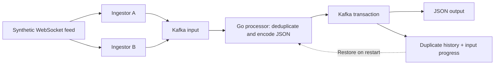

# Reliable event streaming in Go

Two ingestion paths can deliver the same event. This project shows how to process those copies safely, keep memory bounded, and recover consistent state after a restart.

It is a hands-on Go backend showcase: a synthetic market feed, redundant ingestion, Kafka buffering, and a processor that commits output, duplicate history, and progress together.

## The problem

A live feed cannot always replay an update missed during a connection failure. Running two ingestors reduces dependence on one connection, but creates a new problem: both can deliver the same update. Kafka stores those copies at different offsets, so offsets alone cannot identify duplicates.

Each source event therefore carries a stable ID. The Go processor uses that ID to suppress repeated deliveries, including after restart, while the ID remains in its bounded history.

## How the pieces fit



1. **Generate and receive.** The source produces binary market quotes with a source-run ID and sequence. A and B preserve the identity and instrument key when publishing to Kafka.
2. **Check identity.** Each sequential partition owner checks committed history and the current batch. A repeated ID is skipped; a different ID with the same price is still a new event.
3. **Prepare output.** Unique quotes become JSON using reusable, processor-owned buffers.
4. **Commit together.** One Kafka transaction saves output, changed history slots, and the next input position. Only then are pending IDs promoted into local committed history. Downstream readers use `read_committed`.
5. **Recover.** A replacement processor restores the saved position, retained IDs, and eviction order before reading more input.

The feed uses a Kite-style binary schema. It is synthetic and does not connect to Zerodha or a live trading account.

## Design highlight: deduplication that survives restart

The interesting part is not just checking a map. It is keeping that map consistent with durable output without letting history grow forever.

- A **committed map** answers whether an ID was saved by an earlier successful transaction.
- A **pending map** catches repeats inside the current batch without declaring them durable too early.
- A **ring buffer** preserves FIFO order: when history is full, overwrite one slot and remove its old ID from the map. No shifting or full-history scan.
- An **ordered pending slice** preserves first-accepted order; Go map iteration cannot do that.
- A **Kafka transaction** persists output, FIFO changes, and input progress together. Restart rebuilds matching local state, even if Kafka committed just before the process stopped.

**[Read the deduplication walkthrough →](process/docs/deduplication.md)**

Follow a ten-slot example through duplicate detection, wraparound, the actual Go struct, commit ordering, and failure recovery.

## Selected performance evidence

Performance matters only if the output is correct. These are existing local measurements, not capacity promises:

| Measurement | Recorded result | What was measured |
| --- | --- | --- |
| Connected pipeline | **57,599 committed unique outputs/sec** | 9,800,970 Kafka input records became 4,911,750 unique outputs; time includes startup, shutdown, and drain. |
| Full-window deduplication | **0 B/op, 0 allocs/op** | Tested in-memory staging, local commit, and FIFO eviction with one million retained IDs; excludes startup, Kafka, and JSON encoding. |

The pipeline run was recorded on 12 October 2026 with Go 1.27.1 on Apple M1/macOS arm64, one local Kafka broker (replication factor 1), one processing partition, two ingestors, and ten instruments. It offered 100,000 unique events/sec for 60 seconds; the measured interval including drain was 85.274 seconds. The verifier checked output IDs and SHA-256 payload/key fingerprints against Kafka-stored input. It does not establish delivery of every generated source event, maximum sustained capacity, or multi-broker fault tolerance.

The allocation result is from three 200 ms full-window samples on the same machine/toolchain. It describes those tested paths, not all Go map workloads or the whole service.

[Pipeline run and reproduction](process/docs/demo.md#verified-local-run--12-october-2026) · [Deduplication results and exclusions](process/BENCHMARKS.md#deduplication)

## Try the correctness demo

You need Go matching [go.work](go.work), Make, and a running transaction-capable Kafka broker at `localhost:9092`. The demo does not install or start Kafka. A single development broker needs `transaction.state.log.replication.factor=1` and `transaction.state.log.min.isr=1`, plus permission to create/delete topics and use compacted state topics.

From the repository root:

```bash
make demo
```

The demo builds and runs the real services. It verifies duplicate suppression, stops and restarts the processor, then checks that a retained duplicate is still suppressed and fresh events are delivered. It prints `PASS`/`FAIL`, exits non-zero on failure, and cleans up its own services and topics while leaving Kafka running.

[Prerequisites, illustrative output, and cleanup](process/docs/demo.md). For a bounded performance run:

```bash
make demo-performance INPUT_TPS=100000 DURATION=60s
```

`INPUT_TPS` is offered load before A/B duplication, not guaranteed achieved throughput. The performance demo uses temporary disk for verification; see its [measurement and resource limits](process/docs/demo.md#disk-backed-verifier-and-limits).

## Guarantees and limits

- **Bounded duplicate protection.** By default, each partition retains one million committed unique IDs. Duplicate reads do not refresh their position. Evicted IDs can be accepted again; this is not unlimited exactly-once delivery.
- **Kafka is the durability boundary.** At least one ingestor must receive and successfully publish an event. Source outages and events lost before Kafka are outside the guarantee.
- **Partition-local state.** Copies must route to the same partition. Owners are assigned explicitly; automatic reassignment is not implemented. Stable transactional IDs fence replaced producers.
- **Recovery must be complete.** Missing or incompatible state stops startup. State topics require compact-only retention; changing FIFO capacity or partition routing needs a migration plan.
- **Output ends at Kafka.** Database writes and HTTP side effects require their own consistency design. Local single-broker verification does not prove replicated broker failure tolerance.

## Explore the code

| Area | Start here |
| --- | --- |
| Design choices and tradeoffs | [Architecture decisions](docs/design-decisions.md) |
| Deduplication, memory ownership, and recovery | [One complete walkthrough](process/docs/deduplication.md) |
| Source generation and WebSocket delivery | [Source README](websocket-source/README.md) |
| A/B ingestion and acknowledged Kafka publishing | [Ingestor README](ingestor/README.md) |
| Processing, transactions, configuration, and benchmarks | [Process README](process/README.md) |
| Shared event protocol and logging | [Shared packages](pkg/README.md) |

Module READMEs link to their code journeys and detailed benchmark records. No local setup is needed to read them.

## Automated checks

```bash
make build
make vet
make test
```

GitHub Actions runs these commands on pull requests and pushes to `main`, using the Go version in `go.work`. Tests include the race detector across all four workspace modules. Broker-backed integration tests are opt-in (`STREAM_EOS_KAFKA_TEST=1`) and do not run in this CI job; benchmarks and live demos also run separately. A green CI check does not establish Kafka transaction/recovery behaviour.
