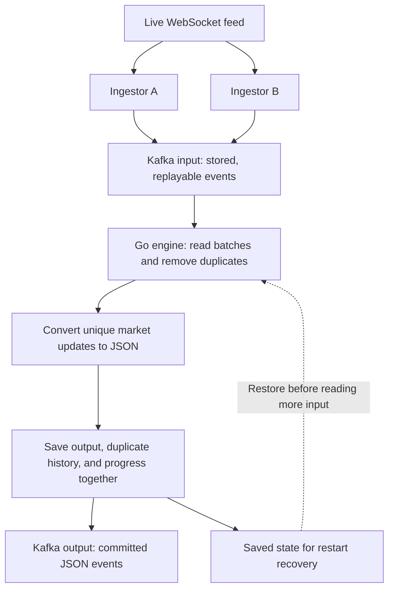

# From a live feed to a recoverable stream

**A short introduction to a Go backend engineering showcase.**

This project turns live market-data events into a replayable stream, removes repeated deliveries, and produces structured output. It demonstrates streaming reliability, careful memory management, and performance measurement in Go.

## The problem

A live WebSocket feed delivers updates as they happen. For this project, the feed offers no replay: an update missed during a connection failure cannot be requested again.

Two independent ingestion services receive the feed to reduce reliance on a single connection or process. Both may receive the same update, so duplicate deliveries are expected. The processing engine must handle those copies, remember its progress, and recover after a restart.

## The journey

### 1. A market update arrives

The demonstration source generates realistic synthetic quotes: prices, traded volume, timestamps, and buy/sell order-book levels. Each update receives a unique event ID before delivery. Both ingestion services receive the same ID for the same update.

The data follows a Kite-style binary format; the project does not connect to live Zerodha trading data.

### 2. Two ingestion services store it in Kafka

Ingestors A and B independently publish received updates to the Kafka input topic. A topic is a stored stream that other services can read. Both services may publish a copy of the same event.

**Replayability starts when Kafka successfully stores the event.** Processing can then pause or restart and read retained events again. Kafka also buffers incoming data while a processor is unavailable, within its storage and retention limits.

### 3. The Go engine reads and removes duplicates

The engine reads events in batches. Kafka divides input into partitions, each handled by its own processor, allowing processing to scale across partitions.

Each processor checks event IDs against its recent duplicate history. If A and B both delivered the same update, only the first accepted copy produces output. A different update with the same price still counts as a new event because its ID differs.

### 4. Unique updates become structured output

The engine converts accepted binary quotes into JSON, a format convenient for downstream applications. It uses bounded batches and reusable buffers to control memory use and reduce repeated allocation.

### 5. Output and recovery information are saved together

One Kafka transaction saves the JSON output, updated duplicate history, and the position from which input processing should resume. These changes become committed together. Downstream readers use Kafka's committed-only reading mode so they do not see output from aborted transactions.

After a restart, the engine restores its saved position and duplicate history before reading more input. It also restores the order in which old IDs will be removed from that history.

For example: both ingestors deliver event **E42**, and the engine publishes one JSON event. The processor restarts. A later copy of **E42** is still suppressed while its ID remains in the restored duplicate window.

## What this demonstrates

| Engineering capability | How the project demonstrates it |
| --- | --- |
| Streaming systems | Live ingestion, durable buffering, batch processing, and independent partition owners. |
| Failure recovery | Output, duplicate state, and progress commit together; restart restores matching state. |
| Go performance engineering | Bounded memory, reusable buffers, and benchmarks that separate local processing costs from Kafka I/O. |
| Engineering judgment | Explicit guarantees, documented tradeoffs, unit tests, and real Kafka recovery tests. |

## The promise and its boundaries

The engine retains the last **1,000,000 committed unique event IDs per partition**, configurable. Duplicate reads do not extend an ID's lifetime. Once an ID is evicted, a later copy can produce output again. The exactly-once claim is bounded by that retained history.

At least one ingestion service must receive an event and successfully store it in Kafka. Events lost before this point cannot be recovered by the engine. Two ingestors reduce dependence on one ingestion path; they do not eliminate source outages or simultaneous failures.

The current project ends at Kafka output. Database delivery is outside this implementation. Local tests use one broker; replicated broker failure tolerance and sustained end-to-end throughput have not been established.

## Explore further

No local setup is needed to understand the design. Next, read [why we built it this way](design-decisions.md). Technical reviewers can explore the [process journey](../process/docs/journey.md) and [benchmarks](../process/BENCHMARKS.md).
