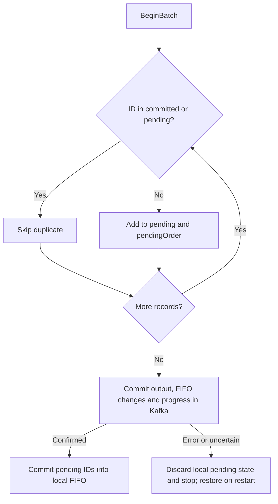

# Deduplication internals

Start with the [simple explanation](../../docs/deduplication.md) for the ring example.

Ingestors A and B may publish the same event at different Kafka offsets. We compare the **source event ID**, not the offset or price. Each ID is a fixed 24-byte value: a 16-byte source-run ID plus an 8-byte sequence.

One partition owner uses one deduplicator sequentially. Copies must reach the same partition for this check to work. The ingestors preserve the instrument key and use the same partitioner; changing partition routing requires a migration plan.

## The data structures

This is the actual [Partition](../internal/dedup/partition.go) struct:

```go
type Partition struct {
    committed    map[protocol.EventID]struct{}
    fifo         []protocol.EventID
    pendingOrder []protocol.EventID
    pending      map[protocol.EventID]struct{}

    next       int
    maxIDs     int
    maxPending int
    partition  int32
    active     bool
}
```

| Field | Plain-English purpose |
| --- | --- |
| `committed` | “Have we already committed this ID?” The empty `struct{}` value makes the map a set. |
| `fifo` | Remembers committed IDs in insertion order so we know which one to evict. Implemented as a ring: reuse slots instead of shifting entries. |
| `pending` | “Have we already accepted this ID in the current batch?” |
| `pendingOrder` | Keeps new IDs in their first-accepted order. Map iteration cannot provide that order. |
| `next` | The next ring slot to write. When full, this is also the oldest ID’s slot. |
| `maxIDs` | Maximum committed history, configurable; default 1,000,000 IDs. |
| `maxPending` | Maximum new IDs allowed in one batch. |
| `partition` | The partition this instance owns. |
| `active` | Whether a batch is open; prevents overlapping batches or staging without one. |

**Maps answer membership questions. Slices preserve order.** We need both. Lookup is expected constant time; a ring insertion overwrites one slot. Duplicate reads do not refresh order, so this is FIFO, not LRU or a time-based expiry policy.

## Follow a batch



`Stage` checks `committed` first, then `pending`. A new ID enters both the pending map and ordered slice. **It does not enter committed history yet.** If pending capacity is exceeded or the partition is wrong, processing fails; it does not silently drop the event and advance progress.

## Why pending is separate

[Processor.Process](../internal/engine/processor.go) calls the [Kafka transaction publisher](../internal/kafka/transaction.go) before calling the deduplicator’s local `Commit`. The local method itself does no Kafka I/O.

If we added an ID to committed history before durable output succeeded, a retry could suppress an event whose output was never saved. Pending state prevents that. `Abort` clears tentative IDs while preserving committed history; the current process stops on errors rather than retrying with an advanced reader position.

If Kafka commits but the process dies before local promotion, startup reloads the committed checkpoint and FIFO slot changelog. Recovery restores membership **and eviction order** before consuming. An uncertain transaction outcome is resolved from Kafka, not guessed from local memory. Even a batch containing only duplicates commits its input progress.

## Memory and evidence

The ring is allocated once at `maxIDs`; the pending slice reserves `maxPending` capacity and cannot grow through accepted batches. Both maps are pre-sized, but Go maps are not fixed arrays and may allocate internally. IDs are copied values; dedup retains no borrowed message buffers.

Full-window benchmarks measured **0 B/op and 0 allocations** for the tested workloads. That is measured evidence, not a promise that every map workload allocates nothing. See [dedup results](../BENCHMARKS.md#deduplication) for timings and exclusions.

The guarantee lasts while an ID remains in the committed window. Restart preserves that window; eviction deliberately ends duplicate protection for that ID.
