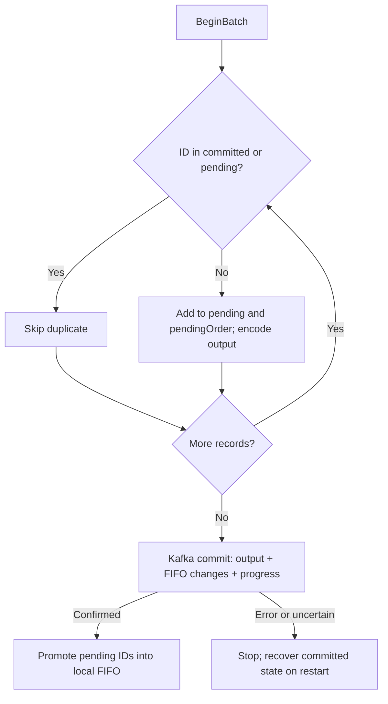

# How deduplication works

Ingestors A and B can deliver the same event at different Kafka offsets. We compare the **source event ID**, not the offset or price. The ID is a copied, fixed 24-byte value: a 16-byte source-run ID plus an 8-byte sequence.

The design combines fast membership checks, bounded FIFO history, and a durable commit boundary. This walkthrough starts with a small example and then connects it to the production code.

[Project overview](../../README.md) · [Processing code journey](journey.md)

## 1. Separate tentative work from committed history

We keep two sets:

- **Committed:** IDs saved by earlier successful Kafka transactions.
- **Pending:** new IDs accepted in the current batch, waiting for Kafka to confirm the transaction.

An ID in either set is a duplicate. A new ID enters pending first. It must not enter committed history until output is durably saved: otherwise, a retry could suppress an event whose output was never committed.

Suppose the batch is `A, B, A, C`:

| Event | Decision |
| --- | --- |
| A | New: add to pending and prepare output. |
| B | New: add to pending and prepare output. |
| A | Already pending: skip the second copy. |
| C | New: add to pending and prepare output. |

Only A, B, and C are new. A later batch containing A finds it in committed history, provided A has not been evicted.

## 2. Preserve order without moving existing IDs

For a separate example, start with ten slots and a batch of four new IDs, `A, B, C, D`:

```text
Before the transaction:
pending:   A B C D
committed: empty
FIFO:      [_ _ _ _ _ _ _ _ _ _]
next = 0
```

Kafka confirms output, duplicate history, and input progress together. Now local promotion fills four slots:

```text
After confirmed commit:
pending:   empty
committed: A B C D
FIFO:      [A B C D _ _ _ _ _ _]
next = 4
```

The map answers membership questions; the FIFO remembers insertion order. Neither needs to scan or shift the existing history for each event.

## 3. Evict the oldest IDs when history is full

After more successful batches:

```text
FIFO: [A B C D E F G H I J]
next = 0
```

The next batch is `K, L, M, N`. It enters pending first. After confirmed Kafka commit, local promotion of K does this (simplified):

```go
delete(committed, fifo[next]) // Forget A.
fifo[next] = id               // Put K in slot 0.
committed[id] = struct{}{}    // Remember K.
next = (next + 1) % capacity  // Slot 1 is next.
```

Repeat for L, M, and N:

```text
FIFO: [K L M N E F G H I J]
next = 4

Read from next and wrap around:
oldest → E F G H I J K L M N → newest
```

This is a **ring buffer**: slots are reused instead of moving all entries. A, B, C, and D have been forgotten; a later copy can produce output again. Duplicate reads do not refresh order, so this is FIFO, not LRU or a time-based expiry policy.

Map lookups take expected constant time. Insertion writes one ring slot; a full-window eviction deletes one map entry. Actual cost depends on map size and memory access, but it does not scan a million retained IDs for each event.

## 4. Connect the example to the Go structures

The actual [Partition](../internal/dedup/partition.go) contains:

```go
type Partition struct {
    committed    map[protocol.EventID]struct{}
    fifo         []protocol.EventID
    pendingOrder []protocol.EventID
    pending      map[protocol.EventID]struct{}

    next       int
    maxIDs     int
    maxPending int
    partition  int32
    active     bool
}
```

| Field | Responsibility |
| --- | --- |
| `committed` | Membership of retained committed IDs; an empty struct makes the map a set. |
| `fifo` | Committed insertion order, stored in reusable ring slots. |
| `pending` | Membership of IDs accepted in the current batch. |
| `pendingOrder` | First-accepted order for promotion and persistence; map iteration is unordered. |
| `next` | Next slot to write; also the oldest occupied slot when full. |
| `maxIDs` / `maxPending` | Bounds on committed history and new IDs per batch. |
| `partition` | The input partition this instance owns. |
| `active` | Guards against overlapping batches or staging outside a batch. |

One owner calls these methods sequentially; the deduplicator is not concurrency-safe. Copies must reach the same partition. Ingestors preserve the instrument key and use the same partitioner; changing routing requires a migration plan.

The ring is allocated once, and the pending slice reserves its maximum capacity. Both maps are pre-sized, but Go maps may still allocate internally. Stored IDs are copied values, so deduplication does not retain borrowed Kafka message buffers.

## 5. Commit durable state before promoting local IDs

[Processor.Process](../internal/engine/processor.go) owns the sequence:



`Stage` checks committed membership, then pending membership. Wrong-partition or pending-capacity errors fail processing; the caller does not silently skip the event and advance progress.

The [transaction publisher](../internal/kafka/transaction.go) stores JSON output, changed FIFO slots, recovery metadata, and the next input offset in one Kafka transaction. The processor waits for confirmed success before calling the deduplicator's local `Commit`. That local method performs no Kafka I/O. Even an all-duplicate batch commits its input progress so the same input need not be read forever.

The processor owns the reusable JSON buffers and keeps them valid through publication and transaction completion. Output readers use `read_committed`, excluding aborted or still-open transactions.

## 6. Recover from Kafka, not guesses about local memory

| Situation | Behaviour |
| --- | --- |
| Failure before a confirmed commit | Discard local pending state and stop. Restart resolves the durable position and retained history from Kafka. |
| Kafka committed, but the process died before local promotion | Restore the committed checkpoint and FIFO changelog; the saved IDs are retained even though local promotion never ran. |
| Transaction outcome is uncertain | Stop and restore from Kafka rather than assuming either success or failure. |
| Recovery state is missing or incompatible | Fail startup rather than process with incomplete duplicate history. |

`Abort` clears tentative IDs and preserves committed history. It is not a substitute for resolving an uncertain Kafka transaction. The service stops on processing errors; it does not retry against an already advanced reader position.

Startup initializes the stable transactional producer first, fencing a replaced owner. It then loads the application checkpoint and FIFO slot changelog, validates the saved capacity, occupied slots, and cursor, and rebuilds committed membership before reading input. Restoring **eviction order as well as membership** ensures a restart does not silently change which IDs remain protected next.

The state topics require compact-only retention. Input progress is an application checkpoint, not a Kafka consumer-group offset commit. FIFO capacity changes, topic resets, and partition migration need an explicit recovery/migration plan.

## Selected evidence

Full-window benchmarks with one million retained IDs measured **0 B/op and 0 allocs/op** for the tested staging/local-commit/eviction paths, across three 200 ms samples on Apple M1, Go 1.27.1, macOS arm64. Startup, Kafka transactions, JSON encoding, and recovery are excluded. This does not imply every map workload or the full service is allocation-free.

[Detailed measurements and commands](../BENCHMARKS.md#deduplication) remain separate from the walkthrough. [The correctness demo](demo.md) exercises the real services and verifies that a retained duplicate is suppressed after processor restart while new events are delivered.

## The guarantee is bounded

The default window retains one million committed unique IDs per partition. Restart preserves that window; eviction deliberately ends protection for an ID. Events must first reach Kafka through at least one successful ingestion path, and downstream readers must use `read_committed`.

The current output boundary is Kafka. Source availability, external database/HTTP side effects, automatic partition reassignment, and replicated broker failure tolerance are outside the demonstrated guarantee.
